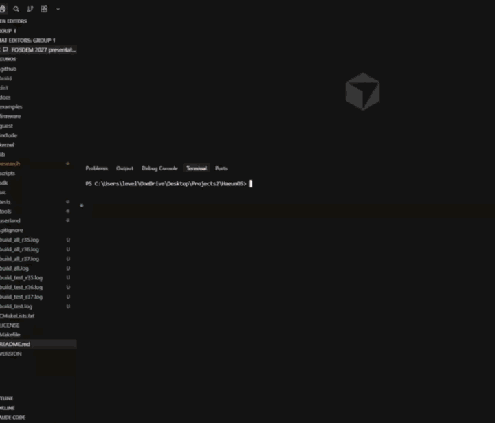

# HAEUN-OS 1.0

[](https://github.com/HaeunJang271/HaeunOS/actions/workflows/linux-ci.yml)



The GIF above is a **short local Win32 viewer session** (Calc / Editor / Files and clean Esc exit). It does **not** represent full product validation, Linux CI, or complete physical HID coverage. See [Validation and test coverage](#validation-and-test-coverage).

### Why HaeunOS?

I wanted to understand how an operating system works beyond what textbooks and existing implementations could teach me.

Rather than studying its components in isolation, I chose to design and implement an operating system myself. By building each part and seeing how the pieces interact, I could learn the underlying principles through hands-on engineering.

HaeunOS began as a learning project driven by one simple question:

**What can I understand about operating systems by building one from the ground up?**

It has since grown into an ongoing systems engineering and research project.

### What is HaeunOS?

HAEUN-OS is a research operating-system stack built around a custom **32-bit guest ISA (HAEUN-32)** and a **host-side C17 interpreter** in [`src/vm.c`](src/vm.c). Guest instructions are interpreted; they are not executed natively by the host CPU.

- Guest kernel model: **modular monolithic** research OS (not a microkernel).
- **Not** RISC-V and **not** derived from RISC-V.
- **Not** a native PC-bootable / bare-metal OS.
- **Not** affiliated with Amiga AROS (AROS Research Operating System); any acronym overlap is coincidental.

Intentional caps and host constraints: [docs/limitations.md](docs/limitations.md).

### What Makes HaeunOS Interesting?

One of the central research questions in HaeunOS AROS is not simply which scheduling policy to choose, but **who is allowed to change the guest's policy and under what conditions**.

The host-assisted AROS pipeline keeps three operations distinct:

- **Evaluation** measures the available guest state and scheduling behavior.
- **Recommendation** may suggest a policy, but a recommendation alone does **not** authorize a guest-state change.
- **Application** is a separate, explicitly enabled operation. SHADOW is the default and reports results without writing the policy.

When APPLY is explicitly requested, the change follows a separate **prepare → validate → commit** path. Validation is fail-closed: an UNKNOWN or failed result is not treated as PASS, and prepare does not itself perform the commit.

This design is implemented for a deliberately narrow scope: changing the guest scheduling-policy word between **round-robin (RR)** and **preemptive FIFO** in a **single-threaded research VM**. It is not evidence of general scheduling-performance superiority, autonomous always-on policy selection, SMP safety, hardware atomicity, or full-system rollback.

The interesting engineering question is therefore the separation of **measurement, recommendation, and authority to mutate state**, together with the explicit limits of the safety contract.

### Linux Quick Start

Requires a C17 compiler, GNU Make, and Python 3. CI uses Ubuntu 24.04 with `build-essential` and Make ([`.github/workflows/linux-ci.yml`](.github/workflows/linux-ci.yml)).

Linux interactive `--viewer` is a **stub**, not a supported interactive viewer. Linux CI does **not** validate physical HID or the Win32 viewer. See [Build and execution model](#build-and-execution-model).

**1. Build**

```sh
make clean
make all
```

**2. Test** (same commands as Linux CI)

```sh
make test
```

**3. Headless execution**

Guest images are not produced by `make all` alone. Build sample images, then run the VM:

```sh
make images
./build/haeun-vm ./build/hello.hxf
```

(`make images` runs `python tools/package_release.py --images-only` after `all`; see [`Makefile`](Makefile).)

Firmware disk boot (after images exist):

```sh
./build/haeun-vm --firmware ./build/boot.hfw --disk ./build/kernel_disk.raw
```

**4. Framebuffer dump**

`--fb-dump` writes a **PPM** (binary P6) of the guest framebuffer. Headless `hello.hxf` is not the GUI dump path. The Make test graph exercises dump via [`tests/m7_guest_gui_tests.py`](tests/m7_guest_gui_tests.py), which builds `build/gui_demo.hxf` and runs:

```sh
python3 tests/m7_guest_gui_tests.py ./build/haeun-vm
# equivalent VM invocation performed by that test:
# ./build/haeun-vm ./build/gui_demo.hxf --gui --user --fb-dump ./build/gui_demo.ppm
```

### Headline Results

| Area | Result | Scope | Source |
|------|--------|-------|--------|
| Linux CI | Ubuntu 24.04 automated build and test workflow | Runs `make clean`, `make all`, and `make test`; this describes workflow coverage, not a historical success count | [`.github/workflows/linux-ci.yml`](.github/workflows/linux-ci.yml) |
| Win32 manual validation | **9/9 PASS** | Live checklist PASS; GIF covers steps 1–5 and 8 only; steps 6/7/9 use separate live-session evidence — not comprehensive physical HID | [`docs/m22.4-manual-validation.md`](docs/m22.4-manual-validation.md) |
| R47 confirmatory experiments | **300** total runs | W1/W2/W3, **100** runs per campaign | [`docs/r47-final-evidence-report.md`](docs/r47-final-evidence-report.md) |
| R47 policy tally | **50/50/0** per policy per campaign | requested/success/fail for RR and FIFO separately | same report |
| R47 discrimination | **H5 not met**; no `SELECT_FIFO` cells | All reported real cells selected **RR**; **not** scheduler performance superiority | same report |

Automated CI and manual Win32 validation are **separate**; do not combine them into one success rate. Details: [Validation and test coverage](#validation-and-test-coverage), [R47 results](#r47-results).

### AROS at a Glance

**AROS** is a **host-assisted** research framework for evaluating and optionally applying guest scheduling-policy changes. It is **not** the guest OS name and is **unrelated** to Amiga AROS.

- **SHADOW** is the default: evaluate/report **without** writing policy.
- **APPLY** requires explicit opt-in through prepare/validate/commit (`haeun_recfg_*` / `haeun_opt_apply`).
- Recommendation alone does **not** authorize a write.
- AROS does **not** claim autonomous always-on policy selection.

Frozen research baseline: annotated Git tag [`v4.6.0`](https://github.com/HaeunJang271/HaeunOS/tree/v4.6.0) (not a GitHub Release object). Full detail: [AROS research details](#aros-research-details).

### Build and execution model

| Host | What runs |
|------|-----------|
| **Linux / POSIX** | Headless CLI VM (`build/haeun-vm`). Interactive `--viewer` uses a **stub** ([`src/vm_viewer_stub.c`](src/vm_viewer_stub.c)). Framebuffer snapshots use `--fb-dump` ([`src/fb_dump.c`](src/fb_dump.c), [`src/main.c`](src/main.c)). |
| **Windows** | Same CLI plus interactive **Win32 GDI viewer** (`--viewer`; [`src/vm_viewer_win32.c`](src/vm_viewer_win32.c)). |

Do not confuse "`--fb-dump` works on Linux (including via `make test`)" with "interactive Win32 viewer works on Linux."

Make selects viewer sources by OS ([`Makefile`](Makefile) Win32 vs stub).

### Windows Viewer Demo

Interactive desktop requires Windows (GDI viewer). `make images` does **not** produce `process_desktop.hxf`. Build the VM, then the desktop image with [`tools/build_process_desktop.py`](tools/build_process_desktop.py) (usage: `build_process_desktop.py <out.hxf>`; creates parent dirs as needed):

```powershell
make all
python tools/build_process_desktop.py build/process_desktop.hxf
.\build\haeun-vm.exe .\build\process_desktop.hxf --apps --persist --viewer
```

For `--apps` builtins, also run `make images` so `build/app_*.hxf` exist (see [`tools/package_release.py`](tools/package_release.py)).

- Calculator / Editor / Files under `--apps` (Files lists **registered app names**, not a full file browser).
- Keys `1`–`3` spawn apps when the shell is focused; Esc closes an app or shuts down the shell.
- Focus the Win32 viewer (and the guest window) for keyboard input.

Recorded partial manual evidence: [docs/assets/haeunos-demo.gif](docs/assets/haeunos-demo.gif). Checklist: [docs/m22.4-manual-validation.md](docs/m22.4-manual-validation.md).

### Validation and test coverage

These layers are **separate**. Do not combine them into one success rate.

#### Automated Linux CI

- Host: **Ubuntu 24.04** ([`.github/workflows/linux-ci.yml`](.github/workflows/linux-ci.yml)).
- Steps: `make clean`, `make all`, `make test`.
- `make test` runs many unit/process tests, including Python tests that invoke `haeun-vm` with **`--fb-dump`** (see [`Makefile`](Makefile) test recipe).
- CI does **not** validate physical keyboard/mouse HID or the interactive Win32 viewer.

#### Manual Win32 viewer validation

- Checklist: [docs/m22.4-manual-validation.md](docs/m22.4-manual-validation.md).
- The current live Win32 manual checklist records **9/9** steps as **PASS**. The demo GIF provides partial visual evidence for steps **1–5 and 8** only; steps **6, 7, and 9** are supported by separate live-session logs and screenshots. This does **not** imply comprehensive physical HID validation.
- Scripted `--input-script` / PPM OCR paths are **not** physical HID PASS.

### AROS research details

**AROS** here is a **host-assisted** research framework for evaluating and (optionally) applying guest scheduling-policy changes. It is **not** the guest OS name and **not** Amiga AROS.

- Host tooling may **evaluate** and **recommend** RR (`0`) or preemptive FIFO (`1`).
- **SHADOW** is the default (evaluate/report without writing policy).
- **APPLY** is explicit opt-in through prepare/validate/commit (`haeun_recfg_*` / `haeun_opt_apply`). Recommendation alone does not authorize a write.
- On failure after write, rollback restores the **previous policy ID only** — not full VM/PCB/memory state.
- AROS does **not** claim autonomous always-on policy selection, general scheduling-performance superiority, ACID/full-system rollback, SMP safety, hardware atomicity, or third-party reproduction.

**Frozen research package:** annotated Git tag [`v4.6.0`](https://github.com/HaeunJang271/HaeunOS/tree/v4.6.0) (R4.5/R4.6; not a GitHub Release object). See [docs/r46-publication-state-clarification.md](docs/r46-publication-state-clarification.md).

**R4.8** is a **post-`v4.6.0` claim-reframing revision on `main`**. It is **not** a new official release tag and does not replace `v4.6.0`.

### R47 results

Recommendation-discrimination follow-up (W1/W2/W3). Canonical report: [docs/r47-final-evidence-report.md](docs/r47-final-evidence-report.md); index: [research/experiments/r47-discrimination/README.md](research/experiments/r47-discrimination/README.md).

| Item | Recorded fact |
|------|----------------|
| Confirmatory campaigns | Gates C (W1), D1 (W2), D2 (W3) |
| Per campaign | **100** runs total = **50 RR + 50 FIFO** (10 reps × 5 profiles × 2 policies) |
| Per-policy tally (each campaign) | requested/success/fail = **50/50/0** (RR and FIFO each) |
| Total confirmatory | **300** runs (3 × 100) |
| Excluded artifacts | Separate step-cap failure under `results/gate-d1/failure-300k/` (not in the confirmatory 300) |
| H5 | **Not met** (negative result) |
| Real cells | No `SELECT_FIFO`; reported cells selected **RR** |

This is a **technical / negative** discrimination outcome under the frozen optimizer contract. It is **not** evidence of general scheduler performance superiority.

### Research documents and versioning

| Kind | Identity |
|------|----------|
| **Product version** | [`VERSION`](VERSION) = `1.0.0` (there is **no** Git tag named `v1.0.0` in this repository) |
| **AROS research baseline** | Git tag `v4.6.0` (annotated; frozen documentation package; not a GitHub Release object) |
| **R4.8** | Research manuscript / technical report revision on `main` ([`research/paper/r48-main-manuscript.md`](research/paper/r48-main-manuscript.md)) |

These are **research manuscripts / technical reports**, not peer-reviewed or externally published journal papers.

| Role | Document |
|------|----------|
| Frozen R4.5 manuscript | [research/paper/r45-main-manuscript.md](research/paper/r45-main-manuscript.md) |
| Publication state clarification | [docs/r46-publication-state-clarification.md](docs/r46-publication-state-clarification.md) |
| R4.6 release notes | [docs/r46-release-notes.md](docs/r46-release-notes.md) |
| R4.8 revised manuscript | [research/paper/r48-main-manuscript.md](research/paper/r48-main-manuscript.md) |
| R47 evidence | [docs/r47-final-evidence-report.md](docs/r47-final-evidence-report.md) |

### FOSDEM 2027 materials

Submission **target**: Kernel Devroom (not an acceptance claim). Materials: [research/presentation/fosdem-2027/](research/presentation/fosdem-2027/).

### Limitations

- Not bare-metal / not PC-bootable; guest ISA is custom HAEUN-32 (not RISC-V).
- Linux interactive viewer is **not** supported (stub only).
- Manual Win32 validation covers the nine documented checklist scenarios. It does not establish comprehensive physical HID coverage or production-grade reliability.
- R47 does **not** establish scheduler performance superiority; H5 was not met.
- AROS does **not** autonomously APPLY policy by default (SHADOW default).
- Broader caps: [docs/limitations.md](docs/limitations.md).

### Requirements and documents

**Requirements**

- C17 compiler, GNU Make, Python 3
- Windows: `pwsh`, WinSock, GDI (`-luser32 -lgdi32`) for interactive viewer
- Make is the authoritative path for the full test graph (CMake covers an older subset)

**Documents**

- [Getting started](docs/getting-started.md) · [Limitations](docs/limitations.md) · [Release notes 1.0](docs/release-notes-1.0.md)
- [Architecture](docs/architecture.md) · [Boot sequence](docs/boot-sequence.md) · [Developer SDK](sdk/docs/README.md)
- [Graphics API](docs/graphics-api.md) · [Networking](docs/networking.md) · [Filesystem](docs/filesystem.md)
- [Isolation](docs/security-isolation-v1.md) · [Faults](docs/fault-handling-v1.md) · [Manual Win32 validation](docs/m22.4-manual-validation.md)

Optional packaging: `make release`, `make sdk` (see [docs/getting-started.md](docs/getting-started.md), [sdk/docs/README.md](sdk/docs/README.md)).

```text
haeun-vm <hxf>|--firmware <hfw> [--disk IMG] [--root-hash HEX]
  [--gui] [--desktop] [--apps] [--app HXF]... [--net|--net-real] [--input]
  [--viewer] [--persist] [--max-steps N] [--user] [--fb-dump PPM]
```

## License

[MIT](LICENSE) — product version [1.0.0](VERSION)
