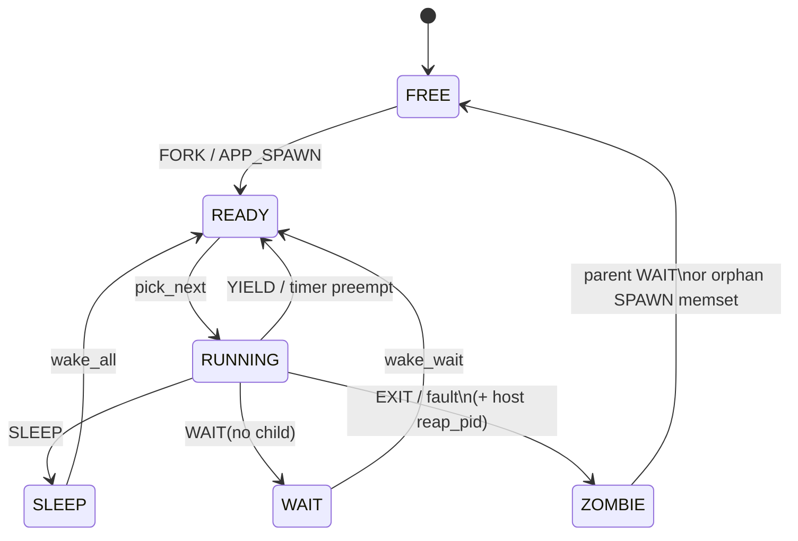

# M24.1 Process Management Architecture Audit

Date: 2026-11-16  
Scope: **read-only**. No source changes.  
Baseline: last full green suite was M23.4 (`make test` exit 0); this milestone did not re-run the suite.

Physical HID: **not claimed**.

## Exact source files inspected

| Area | Paths |
|------|--------|
| Guest PCB layout / docs | `docs/process-v1.md`, `include/haeun/guest_pcb.h`, `src/guest_pcb.c` |
| Guest kernel syscalls | `kernel/process/proc_sys.s`, `proc_fork.s`, `proc_sched.s`, `proc_trap.s`, `proc_boot.s`, `proc_user.s` |
| Host EXIT/fault reap | `src/ecall_mux.c` |
| App SPAWN / scrub | `src/app_env.c`, `include/haeun/app_env.h`, `src/app_env_query.c`, `src/app_ecall.c` |
| Owned resources | `src/evt.c`, `src/ipc.c`, `src/svc.c`, `src/gfx_wm.c`, `src/proc_hfs.c`, `src/net_sock.c`, `src/svc_mgr*.c` |
| ABI numbers | `include/haeun/sec.h` |
| Prior process docs | `docs/process-v1.md`, `docs/process-hfs-v1.md`, `docs/process-hfs-v2.md` |
| Tests (coverage map) | `tests/m17_*`, `m14_*`, `m15_*`, `m16_*`, `m20_*process*`, `m20_*_tests.c`, `m21_*`, `m23_*` (WM ownership only) |

---

## 1. Process architecture (actual)

### Two cooperating layers

HAEUN process management is **not** a single subsystem:

1. **Guest process-v1 kernel** (in-RAM PCB + RR scheduler + `EXIT`/`WAIT`/`FORK`/…).  
2. **Host `haeun_app_env` + `ecall_mux`** (APP_SPAWN into fixed AS slots; host-side resource reap on `EXIT`/fault).

Desktop apps primarily use (2) for create/cleanup and (1) for scheduling/WAIT/zombie PCB state.

### PCB structure (guest RAM)

Base `0x0000A000`, stride `0x100`, **`NPROC = 4`**. Current index `0x0000A400`. Next pid `0x0000A404`.

| Off | Field | Notes |
|----:|-------|-------|
| 0 | `state` | See state table |
| 4 | `pid` | Monotonic from next-pid word |
| 8 | `ppid` | Parent pid |
| 12 | `epc` | Saved user PC |
| 16 | `exit_code` | EXIT arg or fault cause |
| 20 | `sleep_deadline` | Timer `COUNT_LO` |
| 24 | `wait_pid` | 0 = any child (WAIT always writes 0 when blocking) |
| 28 | `ptbr` | AS root |
| 32 | `kstack_top` | |
| 36 | `ustack_top` | |
| 40 | `ustack_base` | |
| 44–56 | `fd[0..3]` | 0 closed; 1 console |
| 64–120 | saved `r1`…`r15` | |

Host mirror of “current pid”: `haeun_guest_pcb_current_pid()` reads `PCB[curr].pid`.

### PID allocation and reuse

- **FORK / APP_SPAWN**: read `0xA404`, assign, increment.  
- **Reuse**: only after PCB returns to `FREE` (WAIT) or orphan zombie memset on next SPAWN.  
- **Wrap**: `uint32_t` increment; no wrap guard observed.  
- **APP_SPAWN** also tracks `env->next_pid` and prefers guest next-pid word when `≥ 2`.

### Address-space slots

| Constant | Value | Meaning |
|----------|------:|---------|
| `HAEUN_GUEST_PCB_NPROC` | 4 | PCB table slots |
| `HAEUN_GUEST_PCB_AS_SLOTS` / `HAEUN_APP_SLOTS` | 3 | Distinct PT/stack/code slots |
| FORK free scan | slots `0..2` only | Explicit comment: PCB3 would alias AS2 |

**Confirmed limitation:** PCB table size ≠ usable AS count.

### Creation paths

| Path | Entry | Effect |
|------|-------|--------|
| `FORK` (5) | `proc_fork.s` | Free PCB `0..2`, copy GPRs, new pid/ppid, READY, child `r1=0`, parent `r1=child` |
| `APP_SPAWN` (26) | `haeun_app_spawn` | Free AS slot `1..2` with `STATE_FREE` PCB; load HXF; READY; host `runs[]` |
| `EXEC` (6) | `sys_exec` | Replace `epc`, reset user stack pointers in PCB (same pid) |

Init/desktop typically occupies slot 0; apps use 1–2 → **at most two concurrent APP_SPAWN apps** (+ optional FORK within AS budget).

### EXIT / fault / WAIT (end-to-end)

```
Guest ECALL EXIT(r2)
  → host ecall_mux: reap_pid(pid)   [WM, evt, ipc, svc, socks, proc fds, app scrub]
  → return false → guest trap continues
  → sys_exit: exit_code=r2, state=ZOMBIE, wake_wait, pick_next

User fatal trap
  → host on_fault: reap_pid(pid, cause) if fault_io installed
  → sys_fault_exit: if not already ZOMBIE → exit_code=cause, ZOMBIE, wake_wait
  → pick_next (idempotent if already ZOMBIE)

WAIT
  → scan ZOMBIE with ppid==self
  → return exit_code; child state=FREE; clear child fd[]
  → else block: state=WAIT, wait_pid=0, pick_next (EPC not advanced)
```

### Scheduler / context switch

- `pick_next`: RR from next index; demotes current `RUNNING→READY`; selects `READY` or `RUNNING`; sets `RUNNING`; `set_curr`; `switch_as` (`ptbr` + `SFENCE`).  
- Timer IRQC: `wake_all` (SLEEP deadlines) → `pick_next` → re-arm (+32 ticks).  
- `YIELD`: READY + pick_next.  
- Switching is **guest trap path on the emulated CPU**, not host thread alternation (`process-v1.md`).

### Parent–child / zombie / orphan

- **Parent WAIT** reaps own `ZOMBIE` children only (`ppid` match).  
- **wake_wait** wakes parents in `WAIT` when any child exits (`wait_pid==0` or matches).  
- **No reparent-to-init** on parent death.  
- **Desktop orphan zombies:** if app `EXIT`s and host cleared `runs[]` without guest WAIT, next `APP_SPAWN` memsets `ZOMBIE` PCB slots with unused `runs[]` (`app_env.c`).

---

## 2. Resource ownership model

| Resource | Owner | Cleanup | Class |
|----------|-------|---------|-------|
| PCB slot | Guest kernel | WAIT → FREE; orphan SPAWN memset | Process-associated |
| AS / code page / ustack scrub | Host `app_env` | `scrub_slot` on `haeun_app_reap` (EXIT/fault) | Process-owned (host) |
| Kernel/user stacks pages | Fixed per AS slot | Reused with slot; not freed to a heap | Kernel-global pool |
| Page tables | Per AS slot | PTE user cleared on scrub | Kernel-global pool |
| Windows (`owner_pid`) | Process | `haeun_app_destroy_windows` in reap | Process-owned |
| Event queues | `owner_pid` slot | `haeun_evt_reap` | Process-owned |
| IPC endpoints | `owner_pid` | `haeun_ipc_reap` | Process-owned |
| IPC name svc registry | pid | `haeun_svc_reap` | Process-owned |
| Service Manager entries | pid | `haeun_sm_on_pid_exit` | Process-owned / pending restart |
| Proc HFS fds | `owner_pid` | `haeun_proc_fds_close_by_owner` | Process-owned |
| Sockets | owner | `haeun_socks_close_by_owner` | Process-owned |
| PCB `fd[0..3]` console marks | PCB | Cleared on WAIT reap | Process-owned (guest) |
| Unowned WM windows | host/chrome | chrome destroy / manual | Shared / host-only |
| Desktop root/strip | unowned | session lifetime | Kernel/host global |

**Timing asymmetry (important):** host resource reap runs **on EXIT ECALL entry**, while guest PCB stays **ZOMBIE** until WAIT (or orphan SPAWN cleanup). Windows/evt/ipc are gone before the zombie is reaped.

---

## 3. Process state matrix

Actual PCB `state` values (no invented enums):

| Value | Name | Meaning |
|------:|------|---------|
| 0 | FREE | Unused / reaped |
| 1 | READY | Runnable |
| 2 | RUNNING | On CPU |
| 3 | SLEEP | Timer sleep |
| 4 | WAIT | Blocked in WAIT |
| 5 | ZOMBIE | Exited/faulted; awaiting WAIT |

There is **no** distinct PCB value for “Created”, “Faulted”, or “Reaped”:

- Created ≈ transition into READY (FORK/SPAWN).  
- Faulted ≈ ZOMBIE with `exit_code = cause`.  
- Reaped ≈ FREE after WAIT (or memset orphan).

| Current | Event | Next | Cleanup |
|---------|-------|------|---------|
| FREE | FORK / APP_SPAWN | READY | Init PCB + AS bind |
| READY | pick_next | RUNNING | AS switch |
| RUNNING | YIELD / preempt | READY | — |
| RUNNING | SLEEP(ticks>0) | SLEEP | Set deadline |
| RUNNING | WAIT (no zombie) | WAIT | wait_pid=0 |
| RUNNING | EXIT / user fault | ZOMBIE | **Host reap_pid**; wake waiting parent |
| SLEEP | deadline ≤ now | READY | Clear deadline |
| WAIT | child EXIT + wake | READY | Then WAIT syscall completes → child FREE |
| ZOMBIE | parent WAIT | FREE | Clear child fds; host already scrubbed AS if APP path |
| ZOMBIE | orphan SPAWN scan | FREE (memset) | Host `runs[]` already unused |
| ZOMBIE | second fault_exit | ZOMBIE | No double state write |
| * (no READY) after EXIT | pick_next fails | halt | Last exit_code in r1 |

---

## 4. Lifecycle diagram



---

## 5. Correctness and risk audit

| Topic | Class | Evidence |
|-------|-------|----------|
| PCB NPROC=4 vs AS slots=3 | **Confirmed limitation** | `guest_pcb.h`, `proc_fork.s` cap at 3 |
| Dual EXIT semantics (host reap then guest ZOMBIE) | **Confirmed limitation** | `ecall_mux.c` + `sys_exit`; easy to confuse “cleaned” vs “reaped” |
| Desktop EXIT without WAIT → zombie PCB until next SPAWN | **Confirmed limitation** | `haeun_app_spawn` orphan memset comment |
| No child reparent on parent death | **Confirmed limitation** | No code path updates `ppid` |
| WAIT ignores selective wait_pid (always any child when blocking) | **Confirmed limitation** | `wt_block` stores 0; field unused for filtering on entry |
| FORK does not copy user memory / only PCB+stacks metadata | **Confirmed limitation** | `sys_fork` copies GPRs + stack pointers, not COW pages |
| APP_SPAWN NOSPC at 2 apps (+ desktop) | **Confirmed limitation** | slots 1..2 only; M21 NOSPC tests |
| PID uint32 wrap | **Potential risk** | Unbounded `+1` |
| Double EXIT after ZOMBIE | **Potential risk** | `sys_exit` no ZOMBIE guard (fault path has); host reap idempotent-ish (`NOENT`) |
| WAIT on unrelated PID | **Not applicable** | WAIT takes no pid arg; only own children |
| Stale focus/windows after EXIT | **Not applicable** (post-M23) | host destroy_windows + focus_recover on reap |
| Fault during host cleanup | **Potential risk** | reap is best-effort `(void)` calls; no transactional rollback |
| Scheduler picking ZOMBIE/WAIT/SLEEP | **Not applicable** | `pick_next` only READY/RUNNING |
| SPAWN exhaustion | **Covered** | NOSPC + tests |
| Zombie accumulation under desktop | **Potential risk** | Mitigated by orphan SPAWN cleanup; not by init reaper |
| Process EXIT owning multiple windows | **Covered** | destroy all `owner_pid`; M23.3/M23.4 |
| EXIT while in WAIT | **Potential risk** | Becomes ZOMBIE; waiting on that process depends on its parent; no special case |
| Pending IPC on EXIT | **Covered (host)** | `haeun_ipc_reap` closes owned endpoints |
| PID reuse with stale host maps | **Potential risk** | Host tables keyed by pid; reuse only after increment; wrap extreme |

No **confirmed defect** requiring emergency ABI break was proven in this read-only pass; dual-layer lifecycle clarity and orphan/WAIT policy are the primary M24 correctness themes.

---

## 6. Existing test coverage

### Real lifecycle / process coverage

| Test | What it actually exercises |
|------|----------------------------|
| `m17_process_fault_tests` | Child fault → ZOMBIE; parent WAIT markers `P`/`O` |
| `m21_3` fault image | Contained fault → halt |
| `m14` / `m15` / `m16` app_env | SPAWN, isolation scrub, reap loops |
| `m20_launcher_tests` | SPAWN/reap; notes WAIT vs host free |
| `m20_*_process_tests` | Apps under process_sdk (EXIT path + host reap) |
| `m21_persistent_desktop` | Launch/reap/NOSPC/Esc |
| `m20` evt/ipc unit | Reap/reuse of queues/endpoints |
| `m23_*` | Window ownership on process exit (not PCB WAIT) |

### Weak / missing as process-management coverage

- Selective WAIT / wait_pid  
- Parent death with live children (orphan policy)  
- Explicit zombie count stress without SPAWN cleanup  
- Double EXIT  
- PID wrap  
- FORK + APP_SPAWN interaction under slot pressure  
- EXIT while parent blocked in WAIT (ordering stress)  
- Guest WAIT after host AS scrub (consistency asserts on PTE/code)  

ABI-constant-only checks (e.g. syscall number equals) are **not** counted as lifecycle coverage.

---

## 7. Baseline test results

- This milestone: **docs only**; suite not re-executed.  
- Prior milestone M23.4: `make clean && make all && make test` → **exit 0**.  
- Physical hardware process validation: **not performed**.
