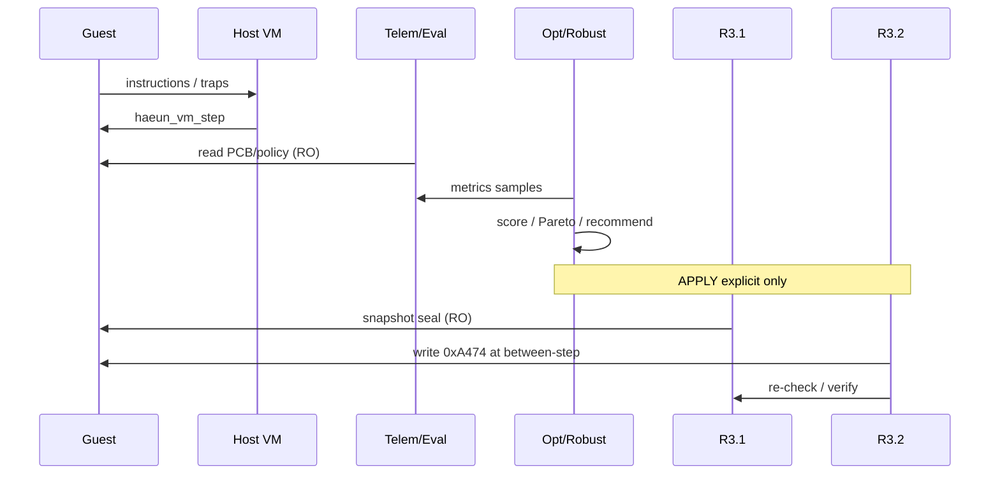

# R4.0 Data Flow

## Knowledge base (host state)

- Current observed policy ID
- Candidate results (RR/FIFO)
- Experiment history (`haeun_rb_experiment`)
- Profile weights / config hash
- Validation reports
- Recommendation + verify status
- Feedback history (R3.5)

Guest RAM is not the knowledge base; host structs/JSON are.
