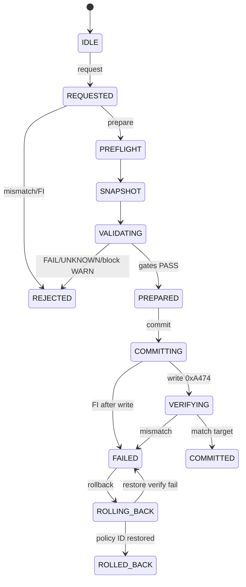

# R4.0 Reconfiguration State Machine

Actual enum (`haeun_recfg_state`):

## Safe point

Between `haeun_vm_step` calls in a single-threaded interpreter (VERIFIED by R3.2/R3.4 design + tests).

## Active transitions

R3.4 requires eligible≥2 + ready_seq PASS for demonstrated mid-run RR↔FIFO under tested images.
