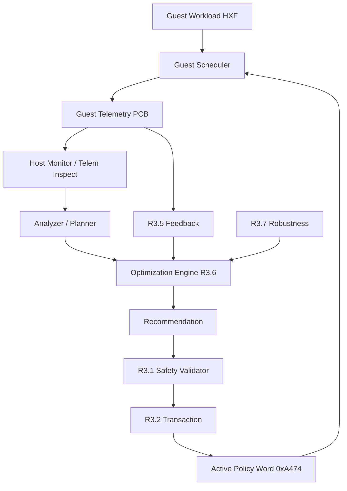

# R4.0 System Architecture (AROS)

Working title: **HaeunOS AROS: An Autonomous Runtime Policy Optimization Framework for Safe Operating System Reconfiguration**

## Logical pipeline

## Component placement

| Stage | Runs in |
|-------|---------|
| Workload / scheduler / telem / ready_seq | Guest kernel |
| Monitor, planner, optimize, feedback, robust | Host research tooling |
| Safety snapshot/validate | Host (reads guest RAM) |
| Policy commit | Host writes `0xA474` via R3.2 only |
| VM step / safe point | Host interpreter |

## Safety boundary

Optimization **must not** write PCB/READY/PTBR/timer.  
R3.1 authoritative; UNKNOWN≠PASS.  
R3.2 sole executor. SHADOW default.
