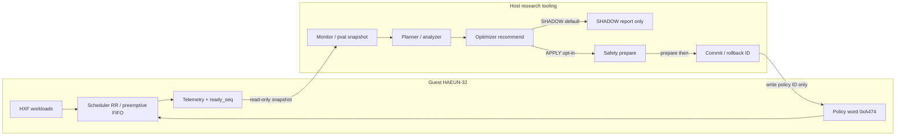

# Figure F1 — HaeunOS AROS system architecture

**Matches:** freeze `386c3a1…`, `docs/r40-system-architecture.md`, R4.4 architecture audit.  
**Editable source:** Mermaid.

**Caption.** Host tooling evaluates guest telemetry and may recommend a policy. SHADOW (default) ends in host report with no `0xA474` write. APPLY is explicit opt-in and alone enters prepare→commit. Recommendation is not authorization; rollback (when used) restores policy ID only.
