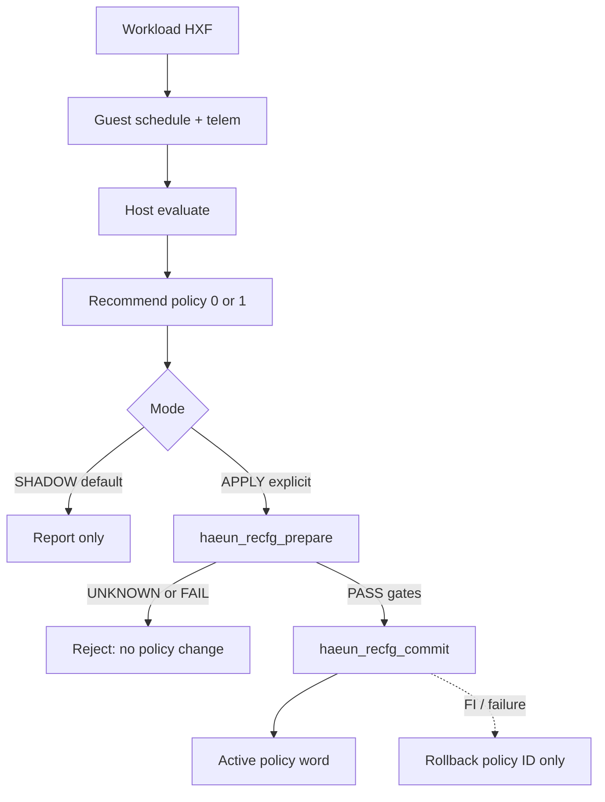

# Figure F2 — Evaluation-to-application pipeline

**Matches:** R4.4 architecture table; `opt_cli` SHADOW/APPLY; `reconfig_txn` prepare≠commit.

**Caption.** SHADOW is default. APPLY is opt-in. Prepare is not commit. Rollback restores policy ID only.
