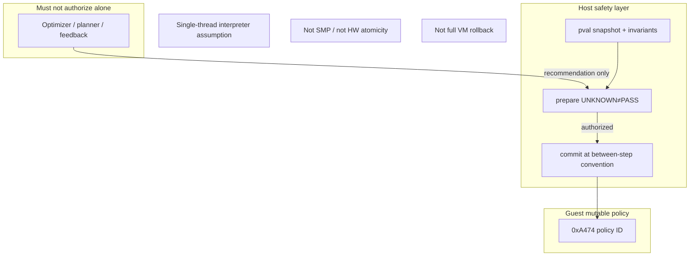

# Figure F3 — Safety boundary and trust separation

**Matches:** `docs/r44-safety-invariant-audit.md`, `r40-safety-model.md`.

**Caption.** Trust separation: recommendation ≠ authorization. Safe-point semantics are interpreter conventions, not hardware atomicity.
