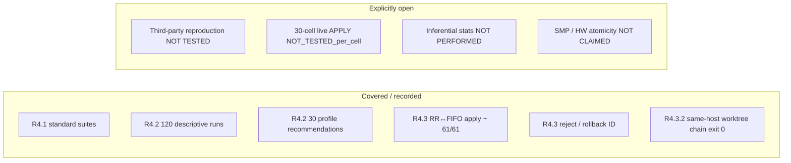

# Figure F4 — Experimental evidence coverage

**Matches:** `docs/r44-experimental-statistics-audit.md` (no new numbers).

**Caption.** Coverage map of existing campaigns versus open limitations. No invented results.
