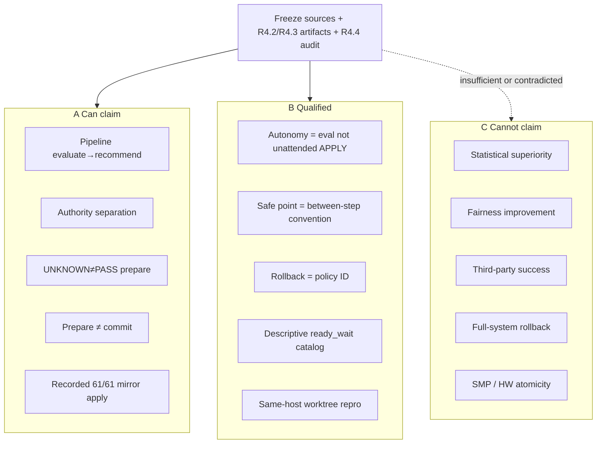

# Figure F5 — Claim / evidence relationship

**Matches:** `docs/r44-claim-evidence-matrix.md` classes A/B/C.

**Caption.** Publication claims must stay in A/B. Class C items are withheld despite proximity to the topic.
